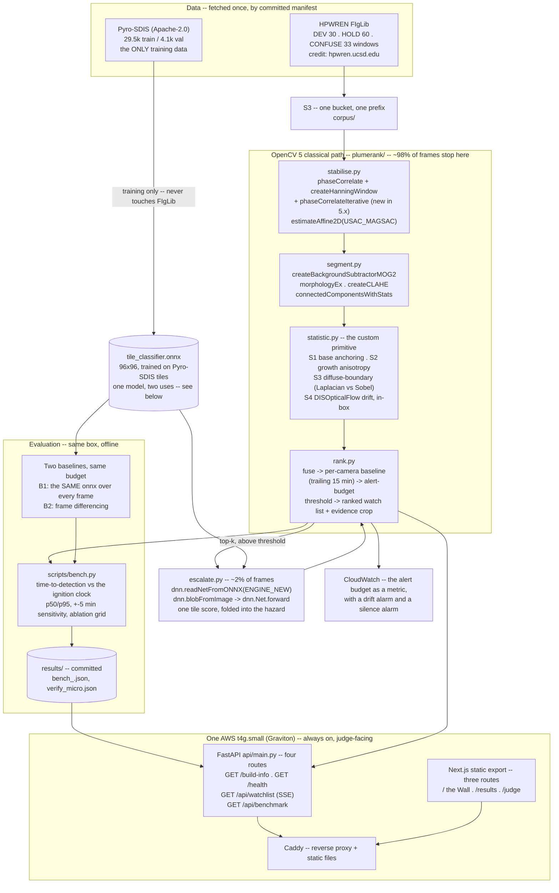

# Architecture

One diagram, four routes, one box. See [`README.md`](README.md) for what the system does and
why; this page is how it is built.

## The one model, two uses

`tile_classifier.onnx` is the **only** trained component. It is run through
`dnn.readNetFromONNX(ENGINE_NEW)` in two different places with two different jobs:

1. **`escalate.py`** -- scores the ~2% of frames the classical statistics flag, and that score
   folds into the fused hazard.
2. **Baseline B1** -- the *identical* model, run over a full-frame tile grid on **every** frame.

Because the model is the same on both sides, a difference between PlumeRank and B1 cannot be
explained by model size -- it isolates the value of the classical anchoring statistic and the
budget calibration. That is the controlled-experiment design the comparison rests on.

## Data flow, in order

**Offline, once** -- `scripts/fetch.py` pulls the corpus named by a committed, sha256-pinned
manifest (never the full archive) into `data/` and `s3://<bucket>/corpus/`.
`scripts/build_confusion_set.py` builds a non-fire confusion set from the same cameras at the
same time of day. `scripts/train_tile_classifier.py` trains the one ONNX model on Pyro-SDIS
**only** (a guard test asserts no FIgLib path ever enters the training manifest). `scripts/bench.py`
runs every arm and writes `results/bench_<date>.json`, which `GET /api/benchmark` then serves
byte-for-byte.

**Online, per replay tick** -- stabilise against the previous frame, segment, measure S1-S4,
fuse into a hazard, rebase that hazard against the camera's own trailing 15 minutes, escalate
the top-k candidates through the ONNX tile classifier, solve the alert-budget threshold, emit
the ranked list with one evidence crop per entry (drawn server-side with `cv2.line` /
`cv2.rectangle` / `cv2.putText`, written with `cv2.imwrite`), and stream it over SSE.

**There is no pre-rendered ranking anywhere on the judged path.** The background model warms
from the pre-ignition frames FIgLib supplies, on screen -- exactly what a real camera start
looks like. `GET /api/benchmark` 404s rather than inventing a number when no HOLD run exists
yet (`plumerank/rank.py`'s `_check_calibration`), and the live Wall shows that honestly instead
of a fabricated ranking.

## API endpoints -- four, all GET

| Path | Returns |
|---|---|
| `GET /build-info` | `cv2.getBuildInformation()` verbatim, `cv2.__version__`, a module-availability probe, the instance id and AMI id, the git commit sha |
| `GET /health` | liveness, uptime, replay state, the live-pipeline availability flag and reason |
| `GET /api/watchlist` | Server-Sent Events: a `meta` event (camera roster, budget, threshold), then one tick per minute |
| `GET /api/benchmark` | `results/bench_<date>.json` served verbatim, or `404` with an explicit message if it does not exist yet |

Evidence crops are static files served by Caddy directly -- image serving never touches the
Python process.

## Why OpenCV 5, not a smaller stack

Take OpenCV 5 out and this does not degrade -- it does not exist. Five modules would each need
a replacement: a background-modelling library for `createBackgroundSubtractorMOG2`, a
phase-correlation stabiliser for `phaseCorrelate`, a robust-estimation library for
`estimateAffine2D(USAC_MAGSAC)`, a dense optical-flow implementation for `DISOpticalFlow_create`,
and a second inference runtime for `dnn.readNetFromONNX`. See `README.md`'s "Why OpenCV 5"
table for the full 23-surface count, mechanically verified by `scripts/check_claims.py` on
every `make test` run.

## Deployment

One `t4g.small` (Graviton/ARM) EC2 instance, one S3 bucket for the corpus, CloudWatch for the
alert-budget metric and a drift/silence alarm, and an IAM instance profile carrying read-only
statements only. `deploy/bootstrap.sh` provisions it from a git bundle in S3;
`deploy/Caddyfile` reverse-proxies `/api/*`, `/health` and `/build-info` to Uvicorn on the same
origin as the static frontend, so there is no cross-origin request in production at all.
