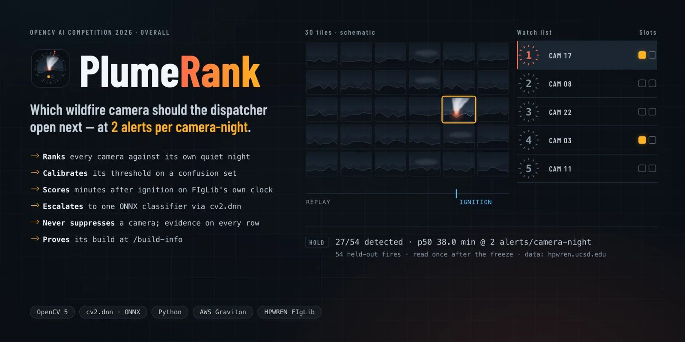
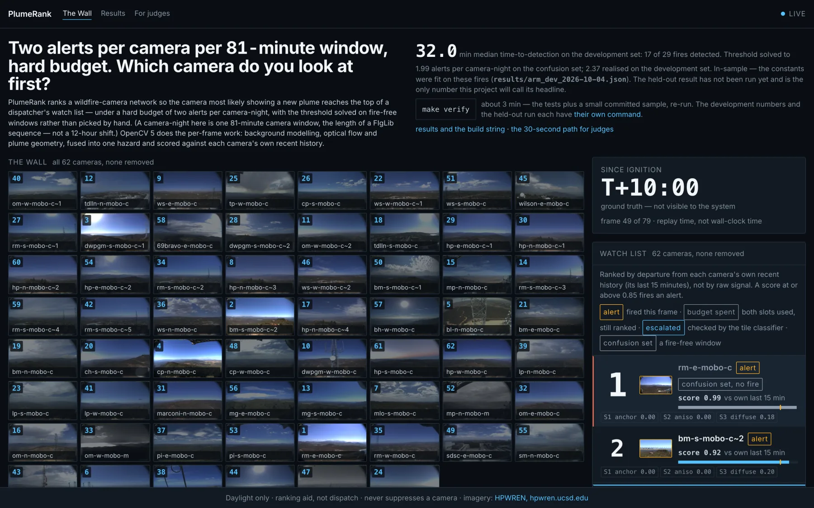

<div align="center">
  <h1>PlumeRank 🔥📷</h1>
  <p><em>A wall of wildfire cameras. One dispatcher. Which one gets opened next?</em></p>
  

  <br/>

  [](http://44.242.91.201)
  [](http://44.242.91.201/judge)
  [](https://plumerank.edycu.dev)
  [](https://plumerank.edycu.dev/pitch/)
  [](https://opencv26.devpost.com/)

  <br/>

  
  
  
  
  
  
  
  [](https://github.com/edycutjong/plumerank/actions/workflows/ci.yml)
  [](https://github.com/edycutjong/plumerank/actions/workflows/codeql.yml)
  [](https://github.com/edycutjong/plumerank/actions/workflows/gitleaks.yml)

</div>

---

## See it in action

<div align="center">
  
</div>

> **The live wall on one Graviton box.** HPWREN FIgLib footage replays through the real
> OpenCV 5 pipeline → every camera is scored against its own last 15 minutes → the watch list
> re-ranks all 62 cameras every second, at a budget of 2 alerts per camera-window.

---

## The question

It is 04:50 on a night shift at a CAL FIRE emergency command centre, and the one dispatcher
awake is looking at a wall of camera tiles (ALERTCalifornia alone runs over 1,000 cameras) with no instrument that tells her which four
to open in the next sixty seconds.

Published smoke detectors are scored on **per-frame accuracy** (F1, precision, recall) or on
time-to-detection with no cap on false alarms. Neither tells her which tile to open, and none of it tells a fire agency whether the system
will survive contact with a real shift before it gets muted. The number that matters is
different: **how many minutes after ignition does a human actually look at the right camera,
given she will only tolerate a fixed number of interruptions per camera?**

**PlumeRank publishes that number.** It watches a camera network and emits, once per frame (one
minute of footage), a ranked shortlist of which cameras a human should look at now — each entry carrying its own
cropped evidence tile — calibrated to a fixed budget of **2 alerts per camera-night**. It never
suppresses a camera and never dispatches an engine. It reorders human attention.

> **The unit.** A *camera-night* in this project is one evaluation window: **81 minutes of
> footage on one camera**, the length of a FIgLib sequence (`plumerank/constants.py`). So the
> budget is 2 alerts per camera per 81-minute window — about 18 per camera over a 12-hour
> shift if run continuously, not 2 per night. The name is the code's; the windows are daytime.

---

## What it actually measures (today, honestly)

> **This project does not yet have a headline number, and says so on purpose.** The held-out
> (HOLD) evaluation — the only run whose number is allowed to be called the headline — has not
> run yet. What exists today is the **DEV** arm (the data the fusion weights were fit on, never
> the number a judge should be shown as proof): **17 of 29 sequences detected, median
> time-to-detection 32.0 minutes**, with the threshold calibrated to 1.99 alerts/camera-night
> on the fire-free confusion set (it realises 2.37 on DEV itself) (`results/arm_dev_2026-10-04.json`).
> That number is for orientation only. Until the HOLD run exists, `/api/benchmark` on the live
> box 404s (there is no `results/bench_*.json` to serve), and the live wall runs on the
> threshold solved on the confusion set by that DEV run — labelled as such on screen. The
> threshold depends only on the confusion set, so it is the one the held-out run will solve
> too. See [`JUDGE.md`](JUDGE.md) and `api/main.py`'s `_calibrated_threshold`.

| Metric | DEV (orientation only — never the claim) |
|---|---|
| Detected | 17 / 29 |
| Median time-to-detection | 32.0 min |
| Alert rate | 1.99 alerts/camera-night on the confusion set (the calibration target is 2.0); 2.37 realised on DEV |
| Escalation fraction (frames touched by the ONNX classifier) | 2.23% — over the 2% design cap the run itself records (`within_max: false`) |
| **B1 through PlumeRank's own per-camera baseline (like-for-like)** | **14 / 29 detected — no median** (2.51 realised on DEV) |
| **B2 through PlumeRank's own per-camera baseline (like-for-like)** | **10 / 29 detected — no median** (2.05 realised on DEV) |
| B1 as deployed (same CNN, every frame, no baseline) | 6 / 29 detected — no median (0.46 realised on DEV; its threshold sits within 1e-6 of 1.0 — saturated CNN probabilities) |
| B2 as deployed (frame differencing, no baseline) | 3 / 29 detected — no median (1.84 realised on DEV) |

Every system is calibrated to the same budget **on the confusion set** (all five land at 1.99).
On DEV the realised rates differ, as listed. The per-sequence results — which sequences each
system catches, when, and which it misses — are in the same file under `per_sequence`, and
summarised in [`REPORT.md`](REPORT.md) §6.

## Honest limitations

1. **Daylight only, and a window-sized budget.** HPWREN FIgLib (the ground-truth dataset) is
   daylight-only and no IR camera exists in this build; a night-shift dispatcher works hours this
   system cannot cover. The budget is calibrated per 81-minute window (see "The unit" above); a
   real deployment would set a per-shift budget and re-solve the threshold for it.
2. **Cloud is the adversary — not the fog this project was designed against — and the
   statistics are weaker than the design assumed.** Measured on 2026-09-06 under the
   *pre-baseline* pipeline (threshold 0.722, not re-measured under the shipped one), low cloud
   cost 4.25 and cloud shadow 3.86 alerts/camera-night against fog's 1.15
   (`results/class_split_2026-09-06.json`) — and a blind census shows the rule that chose the fog windows picks a
   marine layer no more often than chance (29% vs a 29% base rate on unscreened dawn frames;
   `results/fog_census_2026-10-04.md`), so the "fog" class is mostly overcast. The threshold is
   solved on all confusion windows together, so this affects per-class claims only. Per statistic, on DEV frames with a component,
   pre- vs post-ignition: S3 (diffuse boundary) scores AUC 0.44 — anti-predictive — and S1 0.528
   and S2 0.50 are near chance (`results/statistics_confound_2026-09-06.md`). S3 was never tested
   against fog directly. What carries the ranking is scoring each camera against its own
   trailing 15 minutes, not any single statistic.
3. **Two fusion weights are not what the design assumed.** S3 carries the largest fusion weight
   (`FUSION_W_S3 = 4.0931`, `plumerank/constants.py`) despite its AUC of 0.44 on its own, and no
   S3-off ablation has been run yet. Separately, one weight is not identified: refitting moves `FUSION_W_ESCALATION` from +0.78 to
   −0.38 for a 0.0006 change in leave-one-sequence-out AUC; the shipped value is kept because
   it scores two sequences and six minutes of p50 better on DEV
   (`results/refit_through_baseline_2026-09-16.md`). DEV is the tuning arm, so that choice is
   in-sample by construction. Likewise the baseline window: 10 minutes scored 18/29 (p50 30.0)
   against the shipped 15 minutes' 17/29 (p50 32.0) — one sequence apart, inside the noise, and
   kept as a design choice rather than tuned (`results/baseline_calibrated_2026-09-16.md`).
4. **The novelty is a metric reframe, not a new sensor.** The individual OpenCV operations are
   well-known; what is new is the primitive that composes them and the attention-budget
   objective they are pointed at.
5. **One instance, no HA, no static mirror.** The endpoint is a single Graviton `t4g.small`
   (unlimited credit mode), funded by the competition's AWS compute grant.
   Every published number is committed in `results/` so the claim survives the box going down.
6. **No managed cloud vision API baseline.** Both baselines are calibrated to the same alert
   budget as PlumeRank on the confusion set; one of them (B1) shares PlumeRank's own neural network, run over every
   frame instead of the ~2% the classical stage escalates — a controlled experiment, not a
   contest between differently-sized models.
7. **No upload path, no dispatch path, no suppression path — by design, not by omission.** See
   "Responsible use" below.

---

## How it works

Over a rolling, stabilised window, each foreground component on each camera is measured for:

| # | Statistic | Design hypothesis | Measured on its own (DEV, AUC pre- vs post-ignition) |
|---|---|---|---|
| S1 | **Base anchoring** | a fire is tied to the ground; a cloud is not | 0.528 — near chance |
| S2 | **Vertical growth anisotropy** | a plume rises faster than it spreads | 0.50 — chance |
| S3 | **Diffuse-boundary contrast** | smoke has a soft edge | 0.44 — anti-predictive (limitations 2 and 3) |
| S4 | **In-box optical-flow drift** | a plume drifts coherently; sensor noise does not | 0.538 — weak; kept on detection evidence: 17/29 with it vs. 14/29 without under the shipped baseline — though the S4-off run also escalates far fewer frames (0.17% vs 2.23%), so the two effects are not separated |

None of the four is a good detector alone, and per frame the fused model beats the single bit
"a component exists" by only 0.0015 AUC in-sample (`results/statistics_confound_2026-09-06.md`).
What lifts detection is the per-camera baseline below, not the per-frame score.

Those four fold into a per-camera hazard (a fixed logistic, weights fit on DEV, no presence
term). Each camera is then scored against **its own trailing 15 minutes** — a camera that runs
hot all night is not a fire — before a solver calibrates the alert threshold to the budget.

**The learned component never sees a Californian pixel.** The one trained model — a small ONNX
tile classifier reached through `cv2.dnn` — is trained only on Pyro-SDIS (French fire services,
Apache-2.0) and touches only the ~2% of frames the classical stage escalates. That same model
*is* baseline B1, run over every frame instead of 2% of them: PlumeRank cannot win this
comparison by having a bigger model, because the model is identical on both sides.

### Why OpenCV 5, specifically

**Required by the competition**, and structural rather than decorative: 23 defended OpenCV 5
surfaces across 6 modules — 18 analysis calls plus 5 runtime/introspection ones (thread
pinning, timing, build info, and two engine/estimator flags) — mechanically counted from the source by
`scripts/check_claims.py` on every `make test` run (never hand-typed):

| Surface | Lives in | Without it |
|---|---|---|
| `createBackgroundSubtractorMOG2` + `.apply` | `plumerank/segment.py` | a per-pixel Gaussian-mixture background model, rewritten from the paper |
| `phaseCorrelate` + `createHanningWindow` (+ `phaseCorrelateIterative`, new in 5.x) | `plumerank/stabilise.py` | a padded DFT cross-power-spectrum stabiliser with sub-pixel refinement |
| `estimateAffine2D(..., USAC_MAGSAC)` | `plumerank/stabilise.py` | a correct MAGSAC++ implementation |
| `connectedComponentsWithStats`, `Sobel`, `Laplacian` | `plumerank/segment.py`, `plumerank/statistic.py` | the component boxes S1/S2 read, and the boundary energies S3 reads |
| `DISOpticalFlow_create` | `plumerank/statistic.py` (S4) | a dense flow field at usable speed |
| `dnn.readNetFromONNX` (`dnn.ENGINE_NEW`) + `dnn.blobFromImage` + `dnn.Net.forward` | `plumerank/escalate.py` | a second inference runtime on the arm64 box |
| `getBuildInformation` | `api/main.py` → `GET /build-info` | nothing a judge could `curl` to check the OpenCV 5 claim |

The remaining surfaces (two background-subtractor variants kept for the ablation grid, CLAHE
contrast normalisation, morphology clean-up, build/timing introspection) are listed in full by
`scripts/check_claims.py`'s own output.

### Architecture

```
HPWREN FIgLib replay ──▶ stabilise (phaseCorrelate + MAGSAC) ──▶ segment (MOG2 + connected components)
                                                                        │
                                                            S1·S2·S3·S4 statistics
                                                                        │
                                               escalate (~2% of frames) ──▶ ONNX tile classifier (cv2.dnn)
                                                                        │
                                                      fuse ──▶ per-camera baseline (trailing 15 min)
                                                                        │
                                              solve_threshold (alert budget) ──▶ emit (ranked watch list)
                                                                        │
                                   FastAPI (/api/watchlist SSE, /api/benchmark, /health, /build-info)
                                                                        │
                                                        Next.js — the Wall, /results, /judge
```

One t4g.small (Graviton/ARM) instance, one S3 bucket for the corpus, CloudWatch for the alert
budget (the rate on the wall's fire-free cameras, with drift alarms at ±15% — the wall replays
those windows exactly as the benchmark does, so a healthy box reads the calibrated 1.99) and a
heartbeat-silence alarm that reboots the instance if the service stops beating. No Lambda, no managed vision API, no second instance.

---

## Responsible use

1. **Ranking aid for a human, not dispatch.** There is no dispatch path anywhere in this
   codebase (`tests/test_api.py::test_there_is_no_upload_route`, and there is no equivalent
   dispatch route either — `test_exactly_the_four_documented_routes_exist`).
2. **Never hides a camera.** The full roster stays on screen; the system only reorders it.
3. **The alert budget is a published, logged, tunable parameter** — a CloudWatch metric with a
   drift alarm, not a constant buried in a config file.
4. **Every ranked entry ships its evidence crop**, so a human can overrule the ranking in one
   glance.
5. **No new imagery is collected.** The wall replays public HPWREN FIgLib footage of
   landscapes; the only frames it writes are small evidence crops and thumbnails of that
   footage for the screen, overwritten on every replay.

---

## Testing

```
714 passed, 2 skipped · 97% coverage on plumerank/ · ruff clean · mypy clean
```

| Layer | Tool | Notes |
|---|---|---|
| Unit + integration | `pytest` | `make test` — offline, no network, no credentials, ~95s |
| Property-based | `hypothesis` | `tests/test_invariants.py` — **1,500 generated cases** (500 each) property-testing that the fused hazard never leaves `[0, 1]` on valid inputs and never silently passes an invalid one, and that the alert budget is never overspent across generated call sequences |
| Regression | 690+ example tests, most named after the specific behaviour or defect they pin (e.g. `test_an_unusable_threshold_degrades_the_wall_instead_of_500ing_health`) | `tests/` |
| Claim/code consistency | `scripts/check_claims.py` (runs inside `make test`) | every OpenCV symbol, API route, dependency, Makefile target and file path this document names is mechanically checked against the real source — a moved file, renamed symbol or deleted route fails the next test run (counts typed into prose, such as the test total, are not parsed) |
| Static analysis | `ruff check .`, `mypy plumerank api --ignore-missing-imports` | both clean |
| Secret scanning | `gitleaks` (full history) — run locally, 0 findings; GitHub secret scanning + push protection once the repo is public | CI (configured) |
| Dependency audit | `pip-audit`, `npm audit` | CI, advisory |
| SAST | CodeQL (`python`, `javascript-typescript`) | CI (configured; runs once the repo is on GitHub) |
| E2E | Playwright, against the **real** FastAPI backend (no mocks) | `web/e2e/` |

```bash
make test              # offline suite + coverage, ~95s, no network, no credentials
make verify             # ≤3 min: rebuilds .venv, runs the offline suite, then recomputes
                         # the micro-corpus metrics and checks them against the committed
                         # results/verify_micro.json. Does NOT reproduce the published
                         # headline and never claims to.
make fetch && make bench  # ~95 min total: the pair that reproduces the held-out headline
                           # once results/bench_<date>.json exists (HOLD run, pending)
```

See [`DEMO.md`](DEMO.md) for the full reproduce walkthrough and [`JUDGE.md`](JUDGE.md) for the
30-second path.

---

## Getting started

### Backend (root)
```bash
python3 -m venv .venv && .venv/bin/pip install -r requirements-dev.lock
.venv/bin/pip install -e ".[dev]"
.venv/bin/uvicorn api.main:app --reload   # http://127.0.0.1:8000
```

### Frontend (`web/`)
```bash
cd web && npm install
cp .env.example .env.local   # NEXT_PUBLIC_PLUMERANK_API — see web/.env.example
npm run dev                  # http://127.0.0.1:3000
```

No API keys, no accounts, no login anywhere in this stack.

---

## Project structure

```
plumerank/       # the pipeline: stabilise, segment, statistic, escalate, rank, metrics, types
api/             # FastAPI app — /build-info, /health, /api/watchlist, /api/benchmark
scripts/         # fetch.py, bench.py, check_claims.py, check_submission_readiness.py
web/             # Next.js frontend — the Wall ("/"), "/results", "/judge"
tests/           # 714 tests, 97% coverage on plumerank/
deploy/          # EC2 bootstrap (Caddy, systemd, OpenCV 5 build pin)
results/         # committed run artefacts — every published number lives here
```

---

## Track selection

**Overall only.** Neither special-award box is ticked, on purpose:

- **Best Use of COOL — declined.** This pipeline's hot loop is background modelling and optical
  flow, not resize / adaptive-threshold / contours; a COOL claim would benchmark flat against
  that award's own measured-performance criterion.
- **Agentic Vision — declined.** There is no orchestration loop. The dispatcher is
  human-in-command by design — that *is* the safety argument (see "Responsible use" above).

## License

[Apache License 2.0](LICENSE) © 2026 Edy Cu

## Acknowledgments

Built for the **OpenCV AI Competition 2026, powered by AWS**. Imagery: HPWREN FIgLib
(`http://hpwren.ucsd.edu/`). Training data for the single learned component: Pyro-SDIS
(Apache-2.0, French fire services) — never a Californian pixel.
