> **⚠️ Gayriresmî çeviri.** Bu belge, PlumeRank deposunun İngilizce
> [`README.md`](README.md) dosyasının Türkçe topluluk çevirisidir ve
> [@attilayener](https://github.com/attilayener) tarafından hazırlanmıştır.
> Yetkili sürüm her zaman İngilizce orijinaldir; sayılar, teknik ifadeler ve
> herhangi bir uyuşmazlıkta orijinal bağlayıcıdır. Çeviri, upstream'in
> `3c68bbb` commit'ine (10 Ekim 2026) dayanır. Telif ve lisans sahibi Edy Cu'dur
> (Apache License 2.0).

<div align="center">
  

  <h1>PlumeRank 🔥📷</h1>
  <p><em>Yangın kameralarından oluşan bir duvar. Tek bir sevk görevlisi. Sıradaki hangisi açılır?</em></p>
  

  <br/>

  [](https://live.plumerank.edycu.dev)
  [](https://live.plumerank.edycu.dev/judge)
  [](https://plumerank.edycu.dev)
  [](https://plumerank.edycu.dev/pitch/)
  [](https://youtu.be/QqX85JuNfVM)
  [](https://opencv26.devpost.com/)

  <br/>

  
  
  
  
  
  
  
  [](https://github.com/edycutjong/plumerank/actions/workflows/ci.yml)
  [](https://github.com/edycutjong/plumerank/actions/workflows/codeql.yml)
  [](https://github.com/edycutjong/plumerank/actions/workflows/gitleaks.yml)

</div>

---

## Çalışırken görün

**Demo video (3:34):** https://youtu.be/QqX85JuNfVM — canlı duvar, 1. sıraya yükselen bir yangın, elde tutulan sonuçlar, mimari ve sınırlamalar.

<div align="center">
  
</div>

> **Tek bir Graviton makinesindeki canlı duvar.** HPWREN FIgLib görüntüleri gerçek
> OpenCV 5 hattından yeniden oynatılır → her kamera kendi son 15 dakikasına göre
> puanlanır → izleme listesi, kamera-penceresi başına 2 alarm bütçesinde, saniyede
> bir 62 kameranın tamamını yeniden sıralar.

---

## Temel soru

Saat 04:50, bir CAL FIRE acil durum komuta merkezinde gece vardiyasındayız ve ayakta
olan tek sevk görevlisi, önündeki onlarca kamera karosuna bakıyor ([ALERTCalifornia](https://alertcalifornia.org/)
tek başına 1.200'den fazla kamera işletiyor) — ve önümüzdeki altmış saniyede hangi
dört kamerayı açması gerektiğini söyleyen hiçbir alet yok.

Yayımlanmış duman dedektörleri **kare başına doğruluk** (F1, kesinlik, duyarlılık) veya
yanlış alarm sınırı olmaksızın tespit süresi üzerinden puanlanır. Bunların hiçbiri ona
hangi karoyu açacağını söylemez; hiçbiri bir yangın kurumuna, sistemin gerçek bir
vardiyayla temas edip susturulmadan önce ayakta kalıp kalamayacağını söylemez. Önemli
olan sayı farklıdır: **her kameraya yalnızca sabit sayıda kesintiye katlanacağı
göz önüne alındığında, tutuşmadan kaç dakika sonra bir insan gerçekten doğru kameraya
bakıyor?**

**PlumeRank bu sayıyı yayımlar.** Bir kamera ağını izler ve her karede (dakikalık
görüntüde) bir insanın şimdi hangi kameralara bakması gerektiğinin sıralı kısa
listesini üretir — her satır kendi kırpılmış kanıt karosunu taşır — **kamera-gecesi
başına 2 alarm**lık sabit bir bütçeye kalibre edilmiştir. Hiçbir kamerayı asla
bastırmaz ve asla bir tim sevketmez. İnsan dikkatini yeniden sıralar.

> **Birim.** Bu projede bir *kamera-gecesi* (camera-night) — açılış sayfasında
> *kamera-penceresi* (camera-window), Devpost açıklamasında ise *81-dakikalık pencere*
> olarak adlandırılır; bunun 12 saatlik bir gece gibi okunmasını engellemek için —
> tek bir değerlendirme penceresidir: **bir kameradaki 81 dakikalık görüntü**, bir
> FIgLib dizisinin uzunluğu (`plumerank/constants.py`). Dolayısıyla bütçe, kamera
> başına 81 dakikalık pencere başına 2 alarmdır — kesintisiz çalıştırıldığında
> 12 saatlik bir vardiyada kamera başına toplam yaklaşık 18 eder; gecede 2 değil.
> Ad kodundadır; pencereler gündüzdür.

---

## Gerçekte neyi ölçüyor

> **Başlık sonucu — elde tutulan küme, yalnızca bir kez okundu.** **Elde tutulan 54
> FIgLib yangınında** (`data/manifest_hold.json` dosyasında 60 tanesi, 6 tanesi
> `data/excluded.json` dosyasındaki yayımlanmış kural dışında bırakıldı) — hiçbir
> sabitin üzerinde oturtulmadığı dizilerde, sabitler dondurulduktan sonra tam olarak
> bir kez okundu (`results/constants.sha256`, `results/hold_access.log`) — PlumeRank
> **54'ün 27'sini** tespit etti; her kaçırma "asla" sayıldığında **medyan tespit
> süresi 38,0 dakika** oldu; yangınsız karışıklık kümesi üzerinde
> (`results/bench_2026-10-10.json`) **kamera-gecesi başına 2 alarm** bütçesine
> kalibre edilmiş durumdadır. Hiçbir taban çizgi medyana ulaşamaz: PlumeRank'ın
> kendi kamera-başı taban çizgisinden geçirildiğinde aynı CNN 18, kare farkı alma
> ise 20 tespit eder.
>
> **Medyan bir bıçağın sırtında duruyor — ve bu sonucun bir parçası.** Tam olarak
> yangınların yarısı tespit edildiği için var. Tutuşma saati −5…0 dakika kaydırılarak
> yeniden puanlanırsa 32–38 dk okunur; +1…+5 dakika kaydırmada yarısından azı tespit
> edilmiş sayılır ve medyan ortadan kalkar (`results/sensitivity_2026-10-10.csv`).
> Tespit sayıları daha sağlam karşılaştırmadır.

| Ölçüm | **HOLD — başlık sonucu** (54 yangın) | DEV — ayar kolu, örnek içi (29 yangın) |
|---|---|---|
| PlumeRank tespit | **27 / 54** | 17 / 29 |
| Medyan tespit süresi (kaçırma = asla) | **38,0 dk** | 32,0 dk |
| Tespit edilen yangınların ortalama tespit süresi | 13,3 dk | 16,9 dk |
| Alarm oranı | Karışıklık kümesinde kamera-gecesi başına 1,99 (hedef 2,0); HOLD'da gerçekleşen 1,92 | Karışıklık kümesinde 1,99; DEV'de gerçekleşen 2,37 |
| Yükseltme oranı (ONNX sınıflandırıcısına gönderilen kareler) | %1,76 — %2 sınırının içinde | %2,14 — sınırın üzerinde |
| Kamera-gecesi başına CNN çağrısı | 1,4 (PlumeRank) karşısında 3.645 (B1) | 1,8 karşısında 3.645 |
| **Aynı kamera-başı taban çizgisinden geçen B1 (birebir karşılaştırma)** | **18 / 54 — medyan yok** | 14 / 29 — medyan yok |
| **Aynı kamera-başı taban çizgisinden geçen B2 (birebir karşılaştırma)** | **20 / 54 — medyan yok** | 10 / 29 — medyan yok |
| B1 konuşlandırıldığı haliyle (aynı CNN, her karede) | 2 / 54 — medyan yok (eşik 1,0'a 1e-6 içinde: doymuş olasılıklar) | 6 / 29 — medyan yok |
| B2 konuşlandırıldığı haliyle (kare farkı alma) | 4 / 54 — medyan yok | 3 / 29 — medyan yok |

Her sistem **aynı 33 yangınsız pencere üzerinde** aynı bütçeye kalibre edilmiştir
(beşi de 1,99'a düşer). HOLD koşusu yerel bir arm64 makinede yürütüldü
(`run.instance: local (not EC2)`, duvar saati 12dk29sn) — uç nokta makinesinde değil;
yani jüriye hizmet asla riske atılmadı; `make fetch && make bench` bunu her yerde
yeniden üretir. Her sistemin dizibaşına sonuçları her dosyanın `per_sequence`
alanındadır; [`REPORT.md`](REPORT.md) §6 DEV olanları tablolaştırır, sitenin
günlüğü elde tutulan 54 satırın tamamını listeler. Canlı duvar aynı donmuş eşikle
(0,849) çalışır; bu eşik yalnızca karışıklık kümesine bağlıdır.

## Dürüst sınırlamalar

1. **Yalnızca gündüz ve pencere boyutunda bir bütçe.** HPWREN FIgLib (gerçek veri
   kümesi) neredeyse tamamen gündüzdür (elde tutulan koldaki birkaç gece penceresi,
   belirtilen 6 hariç tutmanın 5'idir) ve bu yapımda IR kamera yoktur; gece vardiyası
   sevk görevlisi bu sistemin kapsayamadığı saatlerde çalışır. Bütçe 81 dakikalık
   pencere başına kalibre edilmiştir (yukarıdaki "Birim"e bakın); gerçek bir
   konuşlandırma vardiya başına bütçe belirler ve eşiği ona göre yeniden çözerdi.
2. **Düşman bulut — bu projenin tasarlandığı sis değil — ve istatistikler tasarımın
   varsaydığından zayıf.** 2026-09-06'da, *taban çizgi öncesi* hat altında ölçüldü
   (eşik 0,722; gönderilen hat altında yeniden ölçülmedi): alçak bulut 4,25 ve bulut
   gölgesi 3,86 alarm/kamera-gecesi maliyetindeyken sisinki 1,15'ti
   (`results/class_split_2026-09-06.json`) — ve kör bir sayım, sis pencerelerini seçen
   kuralın bir deniz katmanını rastgelelikten daha sık seçmediğini gösteriyor
   (eleme yapılmamış şafak karelerinde %29'a karşı %29 taban oranı;
   `results/fog_census_2026-10-04.md`); dolayısıyla "sis" sınıfı çoğunlukla kapalı
   hava. Eşik tüm karışıklık pencereleri birlikte üzerinde çözülür, yani bu yalnızca
   sınıf başına iddiaları etkiler. İstatistik bazında, bileşeni olan DEV karelerinde
   tutuşma öncesi/sonrası: S3 (yaygın sınır) AUC 0,44 — ters-öngörümlü — S1 0,528 ve
   S2 0,50 ise şansa yakın (`results/statistics_confound_2026-09-06.md`). S3 hiçbir
   zaman doğrudan sise karşı test edilmedi. Sıralamayı taşıyan şey herhangi bir tek
   istatistik değil, her kameranın kendi izleyen 15 dakikasına göre puanlanmasıdır.
3. **İki birleşim ağırlığı tasarımın varsaydığı gibi değil.** S3, tek başına AUC'si
   0,44 olmasına rağmen en büyük birleşim ağırlığını taşıyor
   (`FUSION_W_S3 = 4.0931`, `plumerank/constants.py`) ve henüz S3-kapalı ablasyonu
   koşulmadı. Ayrıca tek bir ağırlık tanımlı değil: yeniden oturtma,
   `FUSION_W_ESCALATION`'ı dizibaşına-bırak AUC'de 0,0006'lık bir değişim için +0,78'den
   −0,38'e taşıyor; gönderilen değer, DEV'de iki diziyi ve p50'nin altı dakikasını daha
   iyi puanladığı için tutuluyor (`results/refit_through_baseline_2026-09-16.md`).
   DEV ayar koludur, yani bu seçim yapı gereği örnek içidir. Taban çizgi penceresi de
   öyle: 10 dakika 18/29 (p50 30,0) puanlarken gönderilen 15 dakika 17/29 (p50 32,0) —
   bir dizi fark, gürültü içinde, ayarlanmak yerine tasarım tercihi olarak tutuldu
   (`results/baseline_calibrated_2026-09-16.md`).
4. **Yenilik bir metrik yeniden çerçeveleme, yeni bir sensör değil.** Tek tek OpenCV
   işlemleri iyi bilinir; yeni olan onları birleştiren ilkel ve yöneltildikleri
   dikkat-bütçesi hedefidir.
5. **Tek örnek, HA yok, statik yansıma yok.** Uç nokta tek bir Graviton `t4g.small`
   (sınırsız kredi modu), yarışmanın AWS bursuyla finanse ediliyor. Yayımlanan her
   sayı `results/` içinde commit'lenmiştir; iddia, makine kapansa da ayakta kalır.
6. **Yönetilen bulut görü işlemleri API taban çizgisi yok.** İki taban çizgi de
   karışıklık kümesi üzerinde PlumeRank ile aynı alarm bütçesine kalibre edilir;
   bunlardan biri (B1) PlumeRank'ın kendi sinir ağını paylaşır — klasik aşamanın
   yükselttiği ~%2 yerine her karede çalıştırılır — bu farklı boyutlu modeller
   yarışı değil, kontrollü bir deneydir.
7. **Yükleme yolu yok, sevk yolu yok, bastırma yolu yok — tasarım gereği, unutma
   sonucu değil.** Aşağıdaki "Sorumlu kullanım"a bakın.
8. **Sınıflandırıcı yükseltmesi DEV'de bir tespit kazandırmıyor ve gönderilen hücre,
   sayım bakımından en iyi DEV hücresi değil.** On iki hücreli ızgara
   (`results/ablation_2026-10-10.csv`, {MOG2, LSBP, GSOC} × S4 açık/kapalı ×
   yükseltme açık/kapalı, hepsi 2,0 alarm/kamera-gecesi bütçesinde gönderilen
   kamera-başı taban çizgisinden geçer) yükseltme açıkken ve kapalıken altı çiftin
   beşinde aynı sayıda yangın tespit ettiğini, altıncıda açıkken bir eksik
   tespit ettiğini gösterir. Sayımı oynatan bileşen S4'tür (MOG2: 17 varken,
   yokken 14). S4 kapalı GSOC, gönderilen hücrenin 17/29 ve p50 32,0'sına karşı
   18/29 tespit eder; p50 33,0. DEV ayar koludur; yani bunların hiçbiri donmuş
   yapılandırmayı yeniden açmadı: elde tutulan koşu gönderilen hücreyi ölçtü,
   yükseltme dahil — çünkü `constants.py` bu ızgara koşulmadan önce sabitlendi
   (2026-10-04 DEV koşusundan beri hash `02752e86…`) ve ızgara onu değiştirmedi;
   dondurma dosyası ızgaradan sonra, elde tutulan okumadan önce commit'lendi.
   DEV'de sınıflandırıcıya yardımcı olduğu gösterilemiyor.
9. **Stabilizasyon her kareyi ham öncülüne kaydeder ve hareket eden bulut altında
   tahmini kamerayı değil gökyüzünü izler.** `stabilise(prev, cur)`, *t* karesini
   ham *t−1* karesine hizalar; yani gerçek kamera hareketi arka plan modeline bir
   kare gecikmeyle hâlâ ulaşır (`api/main.py` `Replay._tick`, `scripts/bench.py`).
   Stabilizatörün ≥ 1 px büküm uyguladığı her çift zemine karşı hakem edildi —
   karenin satır %55–88'i; zeminin hizasını iyileştiren büküm kameranınkidir,
   kötüleştiren ise değildir (`scripts/measure_registration.py`,
   `results/registration_2026-10-10.json`). DEV'de 55'in 48'i gerçek harekettir,
   hepsi tek kameradan (`20250107_PalisadesFire_69bravo-e-mobo-c`, dakikada 5,7
   px'e kadar) ve büküm hepsinde zemin hizasını iyileştirir. DEV'deki diğer 7 ve
   CONFUSE'daki 39 deÄŸil: zemin medyan 0,07 px (DEV) / 0,04 px (CONFUSE) hareket
   ederken gökyüzü bandı 3,3–14,8 px hareket etti (pencere başına medyanlar) ve
   tam-kare faz korelasyonu ona doğru çekildi. Eşkin üzerinde çözüldüğü yangınsız
   kümede ≥ 1 px'lik her büküm bu yüzden durağın bir sırt çizgisini kaydırır — ve
   maliyeti azdır, karşıolgusal olarak ölçüldü: CONFUSE'u commit'lenen koşunun
   yaptığı gibi yeniden oynatmak (kamera-gecesi başına 1,9885 alarmını ve eşiğini
   tam olarak yeniden üretmek) ve ardından o 39 büküm uygulanmadan tekrar oynatmak,
   eşiksiz eşik aşmalarını 64'ten 63'e, 2,0 bütçesinin çözdüğü eşiği 0,8492'den
   0,8482'ye deÄŸiÅŸtirir (`scripts/measure_registration_alerts.py`,
   `results/registration_alerts_2026-10-10.json`). Etki bükülen kareler yerine
   bütün pencerelere yayılır — bir pencerede bükümleri kaldırmak bir aşma ekler —
   yani kare kare sayılmaz; yangın tespitine etkisi ölçülmedi. Değişmeyen:
   elde tutulan okuma bu hattı ölçtü; kaymayı yalnızca zemin bandında tahmin etmek
   gelecek çalışmanın ilk maddesidir.
10. **Kanıt kırpımı dumanı zamanın yarısından azında gösterir.** Her satırın
    kırpımı kameranın izlenen en büyük ön plan bileşenidir ve sıralama kameraya
    göredir — yani bir yangın kamerası, en büyük hareket eden şeyi bir bulut
    olduğunda bile tepreye ulaşabilir. Her DEV yangınının tutuşma sonrası ilk
    1. sırada veya alarm tikinde, canlı duvarın bir turunda, kırpım bölgesi 21'in
    9'unda dumanı; 7'sinde bulut, 2'sinde güneş veya çıplak gökyüzü, 2'sinde
    arazi, 1'inde belirsizi içerir (`scripts/audit_evidence_crops.py`,
    `results/evidence_first_hits_2026-10-10.json` ve tam çözünürlüklü temas
    sayfası; etiketler gözle, `results/evidence_first_hits_labels.json` içinde).
    Sevk görevlisi kırpımdaki bulutu "tüm karoya bak" olarak okumalıdır, "temiz"
    olarak değil. Gösterilecek bileşeni boyuta göre değil istatistiğe göre seçmek
    gelecek çalışmadır; hiçbir sıralamayı değiştirmez.

---

## Nasıl çalışır

Yuvarlanan, stabilize edilmiş bir pencere üzerinde, her kamera üzerindeki her ön plan
bileşeni şunlar için ölçülür:

| # | İstatistik | Tasarım hipotezi | Tek başına ölçülen (DEV, tutuşma öncesi/sonrası AUC) |
|---|---|---|---|
| S1 | **Tabana bağlanma** | bir yangın zemine bağlıdır; bulut değildir | 0,528 — şansa yakın |
| S2 | **Dikey büyüme anizotropisi** | bir duman sütunu yayıldığından hızlı yükselir | 0,50 — şans |
| S3 | **Yaygın-sınır kontrastı** | dumanın kenarı yumuşaktır | 0,44 — ters-öngörümlü (sınırlama 2 ve 3) |
| S4 | **Kutu içi optik akış sürüklenmesi** | bir duman tutarlı sürüklenir; sensör gürültüsü sürüklenmez | 0,538 — zayıf; tespit kanıtı üzerine tutulur: gönderilen taban çizgisi altında varken 17/29, yokken 14/29 — yine de S4-kapalı koşu çok daha az kare yükseltir (aynı ızgarada %0,17'ye karşı %2,14; o ızgaranın gönderilen hücre yeniden koşusu, aynı sabit hash'i ve eşiğinde 2026-10-04 koşusunun 51'ine karşı 49 kare yükseltti, tespitler özdeş), yani iki etki ayrıştırılmamıştır |

Dördünün hiçbiri tek başına iyi bir dedektör değildir ve kare başına, birleşmiş
model "bir bileşen var" tek bitini örnek içinde yalnızca 0,0015 AUC ile geçer
(`results/statistics_confound_2026-09-06.md`). Tespiti kaldıran aşağıdaki
kamera-başı taban çizgisidir, kare-başı puan değil.

Bu dört, kamera başına bir tehlikeye katlanır (sabit bir lojistik, ağırlıklar DEV
üzerinde oturtulmuş, varlık terimi yok). Ardından her kamera **kendi izleyen 15
dakikasına** göre puanlanır — bütün gece sıcak çalışan bir kamera yangın değildir —
ve bundan sonra bir çözücü, alarm eşiğini bütçeye kalibre eder.

**Öğrenilen bileşen hiçbir Kaliforniya pikseli görmez.** Tek eğitilmiş model —
`cv2.dnn` üzerinden erişilen küçük bir ONNX karo sınıflandırıcısı — yalnızca
Pyro-SDIS (Fransız yangın servisleri, Apache-2.0) üzerinde eğitilmiştir ve
yalnızca klasik aşamanın yükselttiği karelerin ~%2'sine dokunur. Aynı model taban
çizgi B1'in ta kendisidir — %2 yerine her karede çalıştırılır: PlumeRank bu
karşılaştırmayı daha büyük bir modelle kazanamaz, çünkü model iki tarafta da
özdeştir.

### Neden özellikle OpenCV 5

**Yarışma gereği**, ve süs değil yapısal: 6 modülde 23 savunulan OpenCV 5 yüzeyi —
18 analiz çağrısı artı 5 çalışma zamanı/introspeksiyon yüzeyi (iş parçacığı sabitleme,
zamanlama, yapı bilgisi ve iki motor/tahminci bayrağı) — her `make test` koşusunda
kaynak üzerinden mekanik olarak sayılır `scripts/check_claims.py` (asla elle
yazılmaz):

| Yüzey | Bulunduğu yer | Olmasaydı |
|---|---|---|
| `createBackgroundSubtractorMOG2` + `.apply` | `plumerank/segment.py` | makale başına yeniden yazılacak, piksel başına Gauss karışımı arka plan modeli |
| `phaseCorrelate` + `createHanningWindow` (+ OpenCV 4.13 / 5.0'da eklenen `phaseCorrelateIterative`) | `plumerank/stabilise.py` | alt-piksel iyileştirmeli, dolgulu DFT çap-güç-spektrumu stabilize edici |
| `estimateAffine2D(..., USAC_MAGSAC)` | `plumerank/stabilise.py` | doğru bir MAGSAC++ uygulaması |
| `connectedComponentsWithStats`, `Sobel`, `Laplacian` | `plumerank/segment.py`, `plumerank/statistic.py` | S1/S2'nin okuduğu bileşen kutuları ve S3'ün okuduğu sınır enerjileri |
| `DISOpticalFlow_create` | `plumerank/statistic.py` (S4) | kullanılabilir hızda yoğun bir akış alanı |
| `dnn.readNetFromONNX` (`dnn.ENGINE_NEW`) + `dnn.blobFromImage` + `dnn.Net.forward` | `plumerank/escalate.py` | arm64 makinesinde ikinci bir çıkarım çalışma zamanı |
| `getBuildInformation` | `api/main.py` → `GET /build-info` | bir jürinin OpenCV 5 iddiasını doğrulamak için `curl`'leyebileceği bir şey |

Kalan yüzeyler (ablasyon ızgarası için tutulan iki arka plan çıkarıcı varyantı,
CLAHE kontrast normalleştirmesi, morfoloji temizliği, yapı/zamanlama
introspeksiyonu) `scripts/check_claims.py` çıktısında eksiksiz listelenir.

### Mimari

```
HPWREN FIgLib yeniden oynatma ──▶ stabilize et (phaseCorrelate + MAGSAC) ──▶ bölütle (MOG2 + bağlı bileşenler)
                                                                        │
                                                            S1·S2·S3·S4 istatistikleri
                                                                        │
                                               yükselt (karelerin ~%2'si) ──▶ ONNX karo sınıflandırıcısı (cv2.dnn)
                                                                        │
                                                      birleştir ──▶ kamera-başı taban çizgi (izleyen 15 dk)
                                                                        │
                                              eşik çöz (alarm bütçesi) ──▶ yayımla (sıralı izleme listesi)
                                                                        │
                                   FastAPI (/api/watchlist SSE, /api/benchmark, /health, /build-info)
                                                                        │
                                                        Next.js — Duvar, /results, /judge
```

Tek t4g.small (Graviton/ARM) örneği, küme için tek S3 kovası, alarm bütçesi için
CloudWatch (duvarın yangınsız kameralarındaki oran; ±%15 sapma alarmlarıyla — duvar
bu pencereleri kıyaslamanın yaptığı gibi aynen yeniden oynatır, yani sağlıklı bir
makine kalibre edilmiş 1,99'u okur) ve servis atmayı kestiğinde örneği yeniden
başlatan bir kalp-atışı-sessizlik alarmı. Lambda yok, yönetilen görü API'si yok,
ikinci örnek yok.

---

## Sorumlu kullanım

1. **İnsan için sıralama yardımı, sevk değil.** Bu kod tabanında hiçbir yerde sevk
   yolu yoktur (`tests/test_api.py::test_there_is_no_upload_route` ve eÅŸdeÄŸer bir
   sevk yolu da yoktur — `test_exactly_the_four_documented_routes_exist`).
2. **Hiçbir kamerayı asla gizlemez.** Kadronin tamamı ekranda kalır; sistem yalnızca
   sırasını değiştirir.
3. **Alarm bütçesi yayımlanmış, günlüğe yazılan, ayarlanabilir bir parametredir** —
   bir yapılandırma dosyasına gömülü bir sabit değil, sapma alarmı olan bir CloudWatch
   metriÄŸidir.
4. **Her sıralı satır kanıt kırpımını da taşır**, yani bir insan sıralamayı tek
   bakışta geçersiz kılabilir.
5. **Yeni görüntü toplanmaz.** Duvar manzaraların kamuya açık HPWREN FIgLib
   görüntülerini yeniden oynatır; yazdığı tek kareler, ekran için o görüntünün küçük
   kanıt kırpımları ve küçük resimleridir ve her yeniden oynatmada üzerine yazılır.

---

## Test

```
Yerel olarak 832 geçti, 1 atlandı (küme olmadan CI, 820 koşar ve 13'ü atlar) · plumerank/ üzerinde %100 satır kapsamı · ruff temiz · mypy temiz
```

| Katman | Araç | Notlar |
|---|---|---|
| Birim + entegrasyon | `pytest` | `make test` — çevrimdışı, ağ yok, kimlik bilgisi yok, ~2 dk |
| Özellik tabanlı | `hypothesis` | `tests/test_invariants.py` — **1.500 üretilmiş vaka** (her biri 500) özellik testi: birleşmiş tehlikenin geçerli girdilerde asla `[0, 1]` dışına çıkmaması ve geçersiz bir tanesini sessizce geçmemesi; üretilmiş çağrı dizileri boyunca alarm bütçesinin asla aşilmaması |
| Regresyon | 690+ örnek test, çoğu sabitlediği belirli davranış veya hatanın adını taşır (ör. `test_an_unusable_threshold_degrades_the_wall_instead_of_500ing_health`) | `tests/` |
| İddia/kod tutarlılığı | `scripts/check_claims.py` (`make test` içinde koşar) | bu belgenin adını andığı her OpenCV sembolü, API rotası, bağımlılık, Makefile hedefi ve dosya yolu gerçek kaynakla mekanik olarak doğrulanır — taşınan bir dosya, yeniden adlandırılan bir sembol veya silinen bir rota bir sonraki test koşusunu düşürür (metne elle yazılan sayılar, örn. test toplamı, ayrıştırılmaz) |
| Statik analiz | `ruff check .`, `mypy plumerank api --ignore-missing-imports` | her ikisi de temiz |
| Sır taraması | `gitleaks` (tam geçmiş, 0 bulgu) + GitHub sır taraması ve itme koruması (etkin) | CI + depo ayarları |
| Bağımlılık denetimi | `pip-audit`, `npm audit` | CI, danışma amaçlı |
| SAST | CodeQL (`python`, `javascript-typescript`) | CI, her itmede |
| E2E | Playwright, **gerçek** FastAPI arka ucuna (sahte yok) | `web/e2e/` |

```bash
make test              # çevrimdışı paket + kapsam, ~2 dk, ağ yok, kimlik bilgisi yok
make verify             # ≤3 dk: .venv'i yeniden kurar, çevrimdışı paketi koşar, ardından
                         # mikro-küme ölçümlerini yeniden hesaplar ve commit'lenmiş
                         # results/verify_micro.json ile karşılaştırır. Yayımlanan başlık
                         # sonucunu YENİDEN ÜRETMEZ ve asla ürettiğini iddia etmez.
make fetch && make bench  # toplam ~95 dk: elde tutulan başlık sonucunu yeniden üreten çift
                            # (results/bench_2026-10-10.json, commit'lenmiÅŸ)
```

Tam yeniden üretme yürüyüşü için [`DEMO.md`](DEMO.md), 30 saniyelik yol için
[`JUDGE.md`](JUDGE.md) dosyasına bakın.

---

## Başlangıç

### Arka uç (kök)
```bash
python3 -m venv .venv && .venv/bin/pip install -r requirements-dev.lock
.venv/bin/pip install -e ".[dev]"
.venv/bin/uvicorn api.main:app --reload   # http://127.0.0.1:8000
```

### Ön uç (`web/`)
```bash
cd web && npm install
cp .env.example .env.local   # NEXT_PUBLIC_PLUMERANK_API — bkz. web/.env.example
npm run dev                  # http://127.0.0.1:3000
```

Bu yığında hiçbir yerde API anahtarı, hesap veya oturum açma yoktur.

---

## Proje yapısı

```
plumerank/       # hat: stabilize et, bölütle, istatistik, yükselt, sırala, ölçümler, tipler
api/             # FastAPI uygulaması — /build-info, /health, /api/watchlist, /api/benchmark
scripts/         # fetch.py, bench.py, check_claims.py, check_submission_readiness.py
web/             # Next.js ön yüz — Duvar ("/"), "/results", "/judge"
tests/           # 833 test, plumerank/ üzerinde %100 satır kapsamı
deploy/          # EC2 önyükleme (Caddy, systemd, OpenCV 5 yapı sabitlemesi)
results/         # commit'lenmiş koşu yapıtları — yayımlanan her sayı burada yaşar
```

---

## Neyi yanlış yaptık (tarihli)

Kayıttan yazıldı, hafızadan değil; her satır yakalayan dosyayı adlandırır.

- **2026-09-06: başlığımızı biz yanlış aktardık.** Dört belge gönderilen DEV sonucu
  olarak 12/29'u aktardı; o, sonuç dosyası düz `arm_dev_<tarih>.json` adını almış
  S4-kapalı ablasyon hücresiydi. Gönderilen yapılandırma o gün 9/29 ölçtü. Sonuç
  dosya adları artık S4, taban çizgi, arka plan ve bütçe hücrelerini adlandırıyor
  (`scripts/bench.py` `results_filename`; S4 2026-09-06'da
  `results/artefact_provenance_2026-09-06.md` §7 uyarınca, diğer üçü 2026-10-04'te
  `c977858` içinde düzeltildi).
- **Tasarım öncülü sisti; düşman bulut.** Alçak bulut ve bulut gölgesi, sisin 1,15'ine
  karşı 4,25 ve 3,86 alarm/kamera-gecesi'ne mal oldu (taban çizgi öncesi eşik,
  `results/class_split_2026-09-06.json`) ve kör bir sayım, sis pencerelerini seçen
  kuralın bir deniz katmanını rastgelelik sıklığında seçtiğini buldu
  (`results/fog_census_2026-10-04.md`).
- **Tasarımın dayandığı istatistik tek başına ters-öngörümlü.** S3, yaygın-sınır
  kontrastı, bileşeni olan DEV karelerinde AUC 0,44 skorluyor
  (`results/statistics_confound_2026-09-06.md`). Sıralamayı taşıyan her kameranın
  kendi taban çizgisidir.
- **Sınıflandırıcı yükseltmesi DEV tespiti kazanmıyor** (sınırlama 8,
  `results/ablation_2026-10-10.csv`).
- **2026-10-10: test paketi x86-64'te segfault etti** — ilk GitHub CI koşusuna kadar
  görülmedi — ve belgelenen DIS başarısızlık sınırı ("genişlik ≥ 100") özgün
  taramanın test ettiği ilk genişlikti, kenar (80) değil. arm64 üzerinde bite-özdeş
  olarak düzeltildi (`plumerank/statistic.py`, `dis_unmeasurable`).
- **2026-10-10: stabilize edici, kaldırdığı harekete karşı hiç ölçülmemişti — ve ilk
  ölçümümüz yanlıştı.** Dış bir mimari incelemesi kaydın ham öncüle yapıldığını
  gösterdi. Pencere başına tek bir ilkten-sona korelasyon bize kameraların zar zor
  hareket ettiğini, büyük tahminlerin gürültü olduğunu yayımlatmıştı; o 62
  korelasyonun 8'i stabilize edicinin kendi güven tabanının altındaydı
  (`PHASE_RESPONSE_MIN`), iddianın en çok yaslandığı pencere onların arasındaydı ve
  hiçbiri hareket edip geri dönen bir kamerayı göremezdi. Onun yerine zemine karşı
  hakem edildiğinde tek bir kamera gerçekten sallanıyor ve diğer her büyük
  kayma hareket eden gökyüzünü izliyor (sınırlama 9,
  `results/registration_2026-10-10.json`).
- **Elde tutulan medyan bir yangına kadar yok olmaktadır** (27/54; o daha alt sıra
  istatistiğidir, `plumerank/metrics.py` `percentiles`; bkz. "Gerçekte neyi ölçüyor").

## Kategori seçimi

**Yalnızca Genel.** İki özel ödül kutusu da bilinçli olarak işaretlenmedi:

- **COOL'un En İyi Kullanımı — reddedildi.** Bu hattın sıcak döngüsü arka plan
  modelleme ve optik akıştır; yeniden boyutlandırma / uyarlanabilir eşik / kontur
  değil; bir COOL iddiası, o ödülün kendi ölçülen-performans ölçütüne karşı düz
  kalırdı.
- **Agentic Vision — reddedildi.** Orkestrasyon döngüsü yoktur. Sevk görevlisi
  tasarım gereği komutadaki insandır — bu *ta kendisi* güvenlik gerekçesidir
  (yukarıdaki "Sorumlu kullanım"a bakın).

## Lisans

[Apache License 2.0](LICENSE) © 2026 Edy Cu

Bu çeviri, aynı lisansın izinleri uyarınca yapılmıştır; lisans ve telif, orijinal
sahibi Edy Cu'ya aittir.

## Teşekkürler

**OpenCV AI Competition 2026, powered by AWS** için yapıldı. Görüntüler: HPWREN
FIgLib (`http://hpwren.ucsd.edu/`). Tek öğrenilen bileşenin eğitim verisi:
Pyro-SDIS (Apache-2.0, Fransız yangın servisleri) — asla bir Kaliforniya pikseli
deÄŸil.
